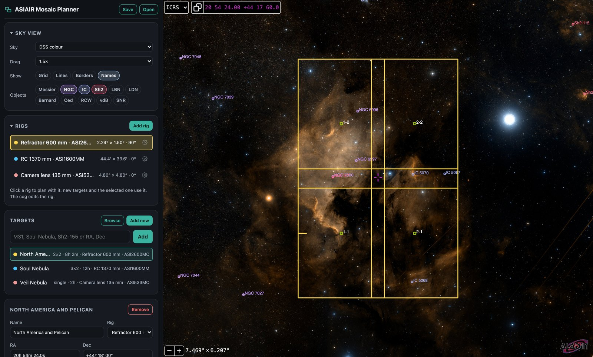
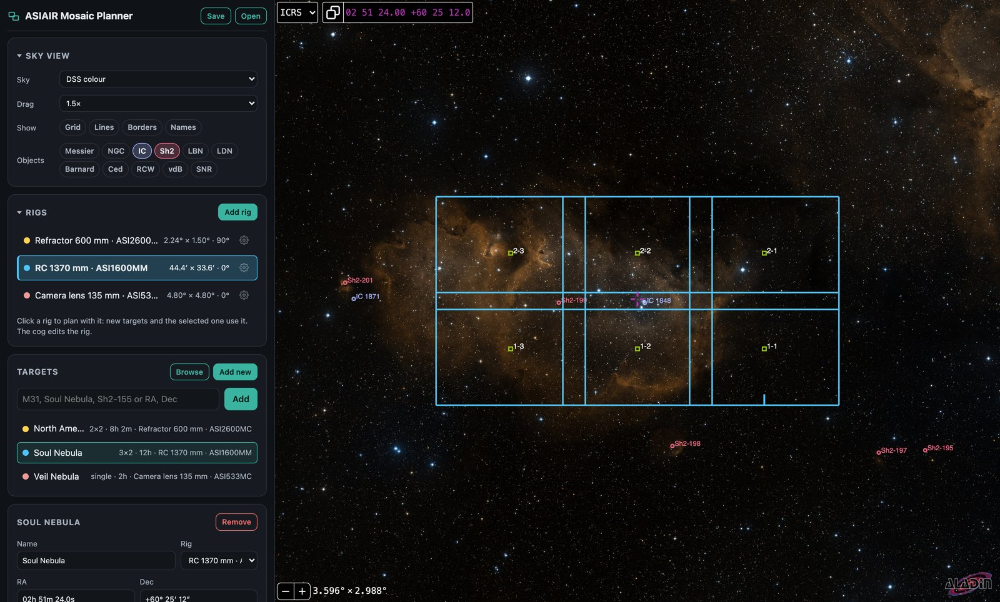
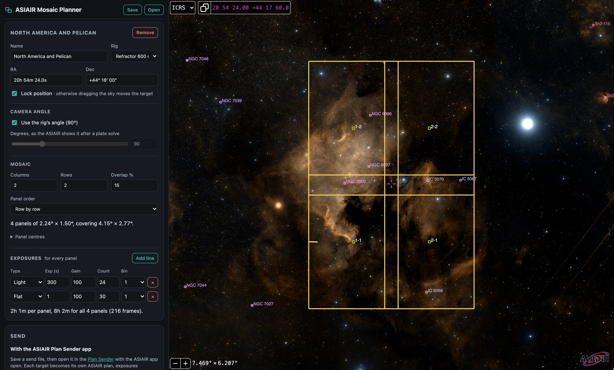
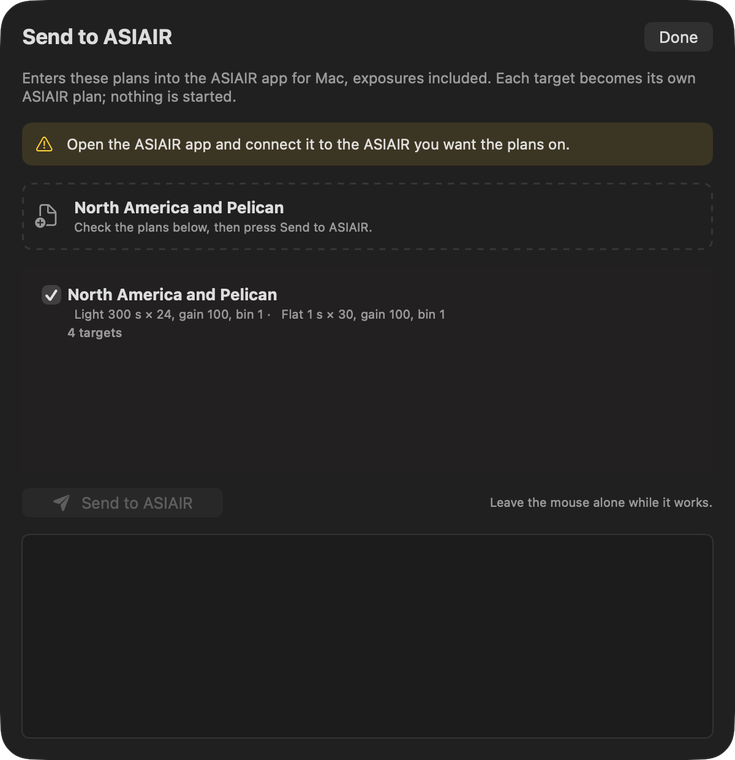

# ASIAIR Mosaic Planner

Plan single targets and mosaics for ZWO ASIAIR rigs on real sky images, during the day, then send them to the ASIAIR app (exposures included) or paste the panels into its plan.

It comes two ways, from the same code:
- **Online:** a single web page with no server of its own, at <https://dgsgc.github.io/asiair-mosaic-planner/app/> (any modern browser, iPad included).
- **Mac app:** the same planner with the sending built in. **[Download it](https://github.com/dgsgc/asiair-mosaic-planner/releases/latest)**.

**Project page:** [dgsgc.github.io/asiair-mosaic-planner](https://dgsgc.github.io/asiair-mosaic-planner/), with screenshots and a quick start.

Your rigs and targets stay in your browser (or in the app). The planner never connects to an ASIAIR itself; plans reach it through ZWO's own app.



## What it does

- **Rigs:** add each rig's focal length and camera (common ZWO cameras are listed), or type the field of view from a plate solve, which is more exact. Each rig gets a colour, so several rigs can be planned side by side. Click a rig to plan with it: new targets use it, and so does the selected target. The rig in use is highlighted in its colour; its cog opens its settings.
- **Targets:** search by name or coordinates, or browse and add one where you are. The search knows about 110 common names imagers use (Soul Nebula, Pacman, Elephant's Trunk, Horsehead…) and suggests them as you type; catalogue numbers work however they're written (Sh2-155, sh2 155, B33, ngc7000); anything else goes to SIMBAD, NED and VizieR. Coordinates can be "05 35 17, -05 23 28", "83.82 -5.39" or "20h51m +30 40". The rig's frame is drawn on sky survey images (DSS, SDSS, Pan-STARRS and others).
- **Sky overlays:** the **Show** buttons switch on a coordinate grid and constellation lines, borders and names. The **Objects** buttons switch on each catalogue by itself: Messier, NGC, IC, Sharpless (Sh2), LBN, LDN, Barnard, Cederblad, RCW, van den Bergh (vdB) and supernova remnants (SNR). All but Messier appear once you zoom in to about 20°. Your choices are remembered.
- **Browsing:** press **Browse** to let go of the selected target, then drag around the sky freely. Press **Add new** to start a target (named Field 1, Field 2…; rename it) wherever the view is pointing.
- **Framing by dragging:** the selected target's frame or mosaic stays in the middle of the sky view; drag the sky underneath it to frame the shot. Tick "Lock position" once you're happy, so later panning doesn't move it. **Drag** (top left) sets how far the sky moves for each mouse drag: 1.5× by default, 1× to follow the mouse exactly. On a touch screen the sky follows your finger.
- **Panel order:** row by row (the default for ASIAIR rigs), or back and forth in DEC: panels are grouped by RA, and each group is swept through DEC, reversing direction each time. Which way the grid is swept follows the camera angle. The order is the order of the pasted or sent panels, so it's the order they're shot in; the panel table numbers them.
- **Mosaics:** set columns, rows, overlap (15% by default, as the ASIAIR app recommends) and angle. The panel centres and each panel's own angle are worked out on the sky, not on a flat grid.
- **Exposures:** give each target its exposure lines (type, exposure, gain, count, binning) and see the time per panel and for the whole mosaic.
- **Sending to the ASIAIR:** in the Mac app, **Send to ASIAIR** enters the plans into the ASIAIR app for Mac, exposures included (see [Sending plans to the ASIAIR](#sending-plans-to-the-asiair)).
- **Into the ASIAIR app by hand:** "Copy this target" or "Copy all for <rig>" puts the panels on the clipboard in the ASIAIR app's own plan text format (the one its Share button writes). Paste it with Import on the app's Plan screen. Panels are named the way the app names its own mosaics, for example `NGC 7000_1-2`.
- **Plan files:** save and open your rigs and targets as a JSON file, to move them to another computer or between the web page and the app.
- **Tidy sidebar:** the Sky view and Rigs cards fold away to one line (showing the survey and the rig in use); the target card is split into Position, Camera angle, Mosaic and Exposures, with sending in its own card.

## Using it

### A quick tour

**1. Plan a mosaic.** Pick a rig on the left, search for a target (or browse and press **Add new**), and set columns and rows. The panels are drawn on the sky, numbered in the order they'll be shot; drag the sky underneath to frame it. Here a 600 mm refractor covers the North America and Pelican nebulae in four panels, with the NGC, IC and Sharpless labels switched on (the picture at the top).

**2. Plan every rig side by side.** Each rig has its own colour, and each target remembers its rig. The Sky view and Rigs cards fold away to one line when you don't need them. Here a 1370 mm RC needs six panels for the Soul Nebula.



**3. Set up the target.** The target card has its position, camera angle (as the ASIAIR shows it after a plate solve), mosaic size and overlap, panel order, and the exposure lines for every panel, with the time per panel and for the whole mosaic.



**4. Send it to the ASIAIR.** In the Mac app, **Send to ASIAIR** opens this panel over the planner. With the ASIAIR app for Mac open and connected, press **Send to ASIAIR**: each target becomes its own ASIAIR plan, every panel with its exposure lines. (Here the ASIAIR app isn't open yet, so the panel says so.) Online, save a send file for the Plan Sender, or copy the panels and paste them into the ASIAIR app.



The screenshots use example rigs and targets.

### Getting it

**Mac app (Apple silicon):** **[download ASIAIR Mosaic Planner](https://github.com/dgsgc/asiair-mosaic-planner/releases/latest)**, unzip it and move it to Applications. It's the same planner, with the Plan Sender built in: **Send to ASIAIR** opens a panel that enters the plans into the ASIAIR app for Mac. Saving, opening and copying use normal Mac dialogs and the clipboard, and your rigs and targets are kept by the app.
- **First opening:** the app isn't signed with a paid Apple developer certificate, so right-click it, choose **Open**, then **Open** again (or System Settings → Privacy & Security → **Open Anyway**).
- **Accessibility:** to send to the ASIAIR it needs System Settings → Privacy & Security → **Accessibility** (the Send panel has a button that opens it). Updates keep this permission. If it ever asks again although the app is switched on there, remove it with **−** and add it again with **+**.
- **Bringing your plans:** press **Save** in the browser planner, then **Open** that file in the app.

**Online:** <https://dgsgc.github.io/asiair-mosaic-planner/app/> works in any modern browser, iPad included. For the ASIAIR it saves a send file for the Plan Sender, or copies the panels.

**On a Mac, in your browser (without the app):** double-click **Open Planner.command**. It serves the planner on this Mac at <http://localhost:8077> and opens it in your browser. The first time, macOS may ask whether to open it: right-click it, choose **Open**, then **Open** again.
- **Same address every time:** your rigs and targets are kept by your browser for that address, so always open the planner the same way.
- **Running in the background:** the planner keeps running after the Terminal window closes, and double-clicking again reuses it.
- **Python:** it needs Python 3. If it's missing, macOS offers to install Apple's command line tools, which include it.

**Anywhere else:** serve the folder with any web server (browsers don't load the planner's modules from `file://`), for example:

```bash
python3 -m http.server 8077 --bind 127.0.0.1
```

then go to <http://localhost:8077>. It can also be hosted as-is on any static web host. The online copy is published by `.github/workflows/pages.yml`, which puts the project page (`site/`) at the top and the planner under `app/`.

## Sending plans to the ASIAIR

The planner can't write to an ASIAIR itself (the ASIAIR only takes plans from ZWO's app). Three ways to get a plan in:

- **Mac app (easiest):** press **Send to ASIAIR: this target** or **…all for <rig>**. A Send panel slides down with the plans; with the ASIAIR app for Mac open and connected, press **Send to ASIAIR** there and leave the mouse alone while it works. Each target becomes its own ASIAIR plan, every panel with its exposure lines; nothing is started. Details and limits: [helper/README.md](helper/README.md).
- **ASIAIR Plan Sender** (from the online planner; Mac, Apple silicon): save a send file with "Send file: this target" or "Send file: all for <rig>", then open it in the [Plan Sender](helper/README.md) with the ASIAIR app open. Each target becomes its own ASIAIR plan, exposures included. [Download the Plan Sender](https://github.com/dgsgc/asiair-mosaic-planner/releases/tag/sender-v0.1.1).
- **By hand:** copy the panels, paste them with Import in the ASIAIR app's plan, and add the exposure lines in the app.

## What the ASIAIR app does with the pasted text

Checked with ASIAIR app 3.0.0:

- **Paste adds targets to the open plan.** Make or open the plan first.
- **Exposures can't be pasted.** The app ignores any extra columns, so add the exposure lines to one panel in the app, then use that panel's copy button, "Copy Schedule to All".
- **Coordinates are J2000.** The app shows them precessed to today's date, so they look a little different. That's expected.
- **No camera angle is stored** for pasted targets. Plate-solve one frame before the first night and set the camera angle to match the angle here.
- **Angles are the ASIAIR's.** Every angle in the planner is the number the ASIAIR shows after a plate solve (or as "Rotation" in its sky atlas). The ASIAIR measures the other way round from a position angle: the frame's top points to 180° − angle, east of north.
- **Panel names:** `_<row>-<col>`, with row 1 along the frame's top and column 1 on its left (at ASIAIR angle 180°, top is north and left is east).
- The app is fussy about the format: Dec must use °, ′ and ″, not ' and ".

## Development

```bash
npm test
```

runs the geometry and search tests (Node 20 or later, no packages needed). One test checks the output against a real Telescopius export.

- `src/mosaic.js` — the geometry and CSV format, with no browser code.
- `src/app.js` — the page: rigs, targets, the sky view, copying and sending (in the Mac app it asks the app through `window.webkit.messageHandlers.host`).
- `src/search.js` — finding targets: common names, catalogue numbers, then Sesame.
- `src/layers.js` — the sky overlays (grid, constellations and the object catalogues).
- `helper/` — the Mac apps (the planner app and the Plan Sender) and the command-line `asiair-send`; see [helper/README.md](helper/README.md).
- Sky view: [Aladin Lite](https://aladin.cds.unistra.fr/AladinLite/) 3.8.2 from jsDelivr. Survey images come from CDS HiPS servers and their mirrors at ESA and IRSA; the page uses the first copy that answers. Pan-STARRS, Mellinger and DESI Legacy only come from CDS, so they're unavailable when CDS is down; DSS colour, DSS red and SDSS colour have copies elsewhere. Common names are in `data/names.json`, made by `tools/build_names.py` (each name is mapped to a catalogue designation, whose position comes from Sesame); other names are looked up with the CDS Sesame service (CDS and Harvard copies). Constellation lines, borders and names and the Messier, NGC and IC lists come from [d3-celestial](https://github.com/ofrohn/d3-celestial) (BSD-3-Clause), loaded from jsDelivr. The complete Sharpless, LBN, LDN and Barnard catalogues are in `data/nebulae.json`, made from VizieR (CDS) by `tools/build_catalogues.py`: Sharpless 1959 (VII/20), Lynds 1965 (VII/9), Lynds 1962 (VII/7A), Barnard 1927 (VII/220A).

## Not affiliated

This is an unofficial tool. It isn't made or supported by ZWO. ASIAIR is a ZWO trademark.
